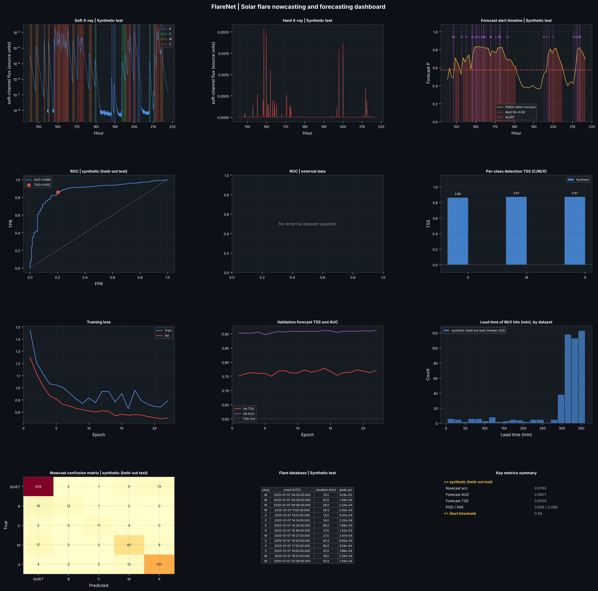

# FlareNet

Solar-flare **nowcasting** (class of the current minute) and **6-hour M/X forecasting** from X-ray
lightcurves. One codebase, any instrument: India's **Aditya-L1** (SoLEXS + HEL1OS), **NASA/NOAA GOES**
(archive files, live feed, your own CSV/NetCDF/JSON) and a synthetic generator. Built for BAH2026
Problem Statement 15 as a pipeline-based Python package with a CLI, YAML configs and tests.



## The pipelines

Each pipeline type is its own sub-package under `src/flarenet/pipelines/`, with its own
`build_pipeline()`, logging, timing and a `manifest_<pipeline>.json` in the run folder. Outputs of
the first three are cached on disk and keyed by a fingerprint of everything that produced them, so
re-runs only redo what changed.

```
 sources/ (plug-ins)        ingestion ──► preprocessing ──► features ──► training ──► evaluation ──► reporting
 synthetic                  fetch raw     resample to 1 min  12 channels   fit on       score on        report.md
 aditya_l1                  samples       scale + label      windows       train        held-out blocks metrics_report.json
 nasa_goes_file                           flare database     block split   sources      + eval sources  dashboard, reliability
 nasa_goes_ncei                                                            checkpoint   CIs, lead time
 nasa_goes_swpc ───────────────────────────────────────────────────────────────────►  inference: predict (files) | monitor (live)
```

| Pipeline | Command | What it does |
|---|---|---|
| ingestion | `flarenet ingest` | Download / read raw data of every configured source into `data/raw/` |
| + preprocessing | `flarenet preprocess` | 1-minute grid, scaling, flare labels, flare database → `data/processed/` |
| + features | `flarenet features` | 12 engineered channels, windows, leakage-safe block split → `data/features/` |
| + training | `flarenet train` | Train on the `role: train` sources, write `runs/<name>/checkpoint.pt` |
| evaluation + reporting | `flarenet evaluate` | Score a checkpoint on held-out blocks and `role: eval` sources, write report + figures |
| everything | `flarenet run` | All of the above in one go |
| experiments | `flarenet experiment` | Compare config variants over several seeds (paired differences, win counts), see [`docs/IMPROVEMENTS.md`](docs/IMPROVEMENTS.md) |
| device check | `flarenet device` | List CPU / Apple MPS / CUDA, benchmark them, recommend one |
| inference | `flarenet predict` / `flarenet monitor` | Forecast over a file source, or loop on the live NOAA/NASA GOES feed |

## Using NASA data

Data sources are plug-ins chosen in the config (`kind:`). Nothing downstream knows which spacecraft
produced the data, so adding NASA data is a few lines of YAML:

```yaml
sources:
  - name: goes16_2024
    kind: nasa_goes_ncei        # downloads GOES-R XRS 1-min science files from NOAA NCEI
    role: train
    params: {satellite: 16, start: 2024-03-01, end: 2024-06-30}
  - name: aditya_l1
    kind: aditya_l1
    role: eval                  # never trained on: the cross-instrument test
    params: {solexs_path: /data/AL1_SOLEXS_....lc, hel1os_dirs: [/data/hel1os/HLS_...]}
```

| `kind` | Data | Labels |
|---|---|---|
| `nasa_goes_ncei` | GOES-R XRS 1-min NetCDF from the NCEI archive, one file per day, downloaded once and cached | GOES-calibrated classes (NOAA-style event detection) |
| `nasa_goes_file` | Your files: GOES-R NetCDF, SWPC JSON, CSV/Parquet from SunPy, CDAWeb, a spreadsheet | same |
| `nasa_goes_swpc` | NOAA SWPC GOES X-ray JSON feed, last 6 h to 7 days (live) | same |
| `aditya_l1` | SoLEXS `.lc` + HEL1OS CZT1 FITS | relative proxy, not GOES classes |
| `synthetic` | Generator with ground-truth flares | exact (but unrealistic Sun) |

Ready-made configs in [`configs/`](configs): `nasa_goes_ncei.yaml`, `nasa_goes_local.yaml`,
`cross_instrument.yaml` (GOES → Aditya-L1), `synthetic_to_nasa.yaml`, `live_monitor.yaml`,
`aditya_l1.yaml`, `default.yaml`. The **DONKI** flare catalog (`api.nasa.gov/DONKI/FLR`) can be used
as label truth (`labeler: catalog`) or as a cross-check of the GOES detector
(`labeler_params: {cross_check: {catalog: donki}}`); `flarenet donki --start ... --end ...` saves it
to CSV. Details, file layouts and caveats: [`docs/NASA_DATA.md`](docs/NASA_DATA.md).

## Setup with uv (recommended, Mac M-series GPU)

```bash
brew install uv        # or: curl -LsSf https://astral.sh/uv/install.sh | sh
cd flarenet
uv sync --python 3.12 --extra netcdf   # creates .venv, installs every dependency from uv.lock
uv run flarenet device                 # should print: available devices: cpu, mps
uv run flarenet run -c configs/mac_mps.yaml   # trains on the Apple GPU (MPS)
```

`bash scripts/setup_mac.sh` runs the first three steps for you. Prefix every command with `uv run`
(or `source .venv/bin/activate`). The model is small, so check `uv run flarenet device --batch-size 512`
to see whether MPS or CPU is faster on your machine. Details: [`docs/APPLE_SILICON.md`](docs/APPLE_SILICON.md).

## Quickstart

```bash
python -m venv .venv && source .venv/bin/activate
pip install -e ".[dev]"            # add the netcdf extra for NOAA/NASA GOES-R files: ".[dev,netcdf]"
# or with uv (Mac M-series, uses the GPU): uv sync --python 3.12 --extra netcdf && uv run flarenet run -c configs/mac_mps.yaml

flarenet run                       # synthetic data, improved defaults, ~4 min on CPU: train, evaluate, report
flarenet run -c configs/fast.yaml  # original single-model settings, ~1 min on CPU (smoke tests)
flarenet run -c configs/nasa_goes_ncei.yaml     # real GOES data (needs internet + netcdf extra)
flarenet sources                   # list registered sources, catalogs, labelers, scalers
pytest                             # tests, no internet needed (under a minute)
```

A run writes `runs/<run_name>/`: `checkpoint.pt` (weights + normaliser + alert threshold + config),
`report.md`, `metrics_report.json`, `visual_dashboard.png`, `reliability.png`, `flare_db_*.csv`,
`lead_time_*.csv`, `history.json`, `config_used.json` and one `manifest_*.json` per pipeline.

Override any config value from the command line, and re-use caches between runs:

```bash
flarenet run -c configs/nasa_goes_ncei.yaml --set training.epochs=60 --set model.cnn_channels=48 \
    --run-name exp1 --data-dir /big/disk/flarenet_data
flarenet evaluate --checkpoint runs/exp1/checkpoint.pt -c configs/cross_instrument.yaml
flarenet predict  --checkpoint runs/exp1/checkpoint.pt -c configs/cross_instrument.yaml --source aditya_l1
flarenet monitor  --checkpoint runs/exp1/checkpoint.pt -c configs/live_monitor.yaml
```

`training.device` is `auto` (CUDA, then Apple MPS, then CPU). **On a Mac, run `flarenet device` to check the GPU and benchmark it against the CPU**; see [`docs/APPLE_SILICON.md`](docs/APPLE_SILICON.md). Use `--force` to ignore caches.

## Model

```
 12 engineered channels x 90 min
           |
   Conv1D(7) + BN + ReLU
           |
   ResBlock(k=5) -> ResBlock(k=3) -> channel dropout -> MaxPool(2) -> ResBlock(k=3)      (shared encoder)
           |
     +-----+------------------------------+
     |                                    |
 1-layer BiLSTM -> last step -> MLP    2-layer BiLSTM -> attention pooling -> MLP
     |                                    |
 5-class nowcast logits             1 forecast logit
```

122,087 parameters per network. By default (`configs/default.yaml`) three networks with different seeds are trained and their probabilities averaged (366,261 parameters in total; `training.ensemble_size`), the training windows are cut every 30 minutes (`data.train_stride_min`), and per-class offsets tuned on the validation set are added to the nowcast logits (`training.nowcast_bias_tuning`). `configs/fast.yaml` turns these off. Mixup, a weighted sampler that oversamples forecast-positive windows,
label-smoothed class-weighted CE (nowcast), focal BCE (forecast), AdamW + cosine decay, early
stopping on **validation TSS**. Train/val/test are split by shuffled **multi-day blocks** so
overlapping windows never straddle splits. Several `role: train` sources are mixed (per-source
`weight`), each split into its own blocks. `training.finetune_from` / `freeze_encoder` allow
fine-tuning a checkpoint (e.g. synthetic or GOES pre-training) on another instrument.

Input channels: log SXR, log HXR, first and second derivatives of both, hardness ratio, 2 h and 6 h
rolling max, 4 h EWMA, 1 h fluence, 6 h recent-flare-rate. Choose a subset with
`features.channels` for ablations.

## Any instrument, and comparing with NOAA

`features.relative: true` measures flux against each detector's own trailing quiet level, so a different
gain or background does not move the model's inputs; `training.aug_*` simulate other detectors during
training; `scaling: goes_calibrated` maps another agency's counts onto GOES flux; `flarenet noaa-compare`
scores a 24 h model once per UTC day like NOAA's forecasts (and against NOAA's own probabilities if you supply
them). On a **simulated** detector change this kept forecast TSS at about 0.50-0.64 where the absolute-feature
model fell to as low as 0.05 ([`docs/ROBUSTNESS_RESULTS.md`](docs/ROBUSTNESS_RESULTS.md)), at a cost of about 0.03 TSS
on the training detector. **It has not been shown to beat NOAA, and no real ISRO/NASA data has been scored.**
Guide: [`docs/UNIVERSAL_INSTRUMENTS.md`](docs/UNIVERSAL_INSTRUMENTS.md); configs `universal_multi_agency.yaml`,
`noaa_daily.yaml`, `instrument_shift.yaml`.

## Daily forecast vs NOAA (same days)

`flarenet daily` forecasts "will an M-class flare start tomorrow (UTC)?" at 22:00 UTC from the GOES flux, flare history
and NOAA's sunspot-region summaries, with a calibrated gradient-boosting + logistic blend, and scores it walk-forward
against NOAA's own archived forecasts on identical days (NOAA as published and NOAA recalibrated the same way, paired
block-bootstrap intervals, feature ablations, a check that any win is consistent over time). `scripts/daily_predict.py` gives
tomorrow's number from the live feed and can keep a forward-test log. **First real run (2019-2026): level with NOAA through
2024, ahead in 2025-26, not established as better overall.** Details: [`docs/DAILY_VS_NOAA.md`](docs/DAILY_VS_NOAA.md); the clean
test of the remaining question: [`docs/FORWARD_TEST.md`](docs/FORWARD_TEST.md).

```bash
uv run flarenet noaa-text --start 2017-03-01 --end 2026-10-01
uv run flarenet daily -c configs/daily_noaa.yaml
```

## Results

All numbers are on **synthetic data** (200 days, held-out 3-day blocks), CPU. Full report of the seed-42 run:
[`docs/example_metrics_report.json`](docs/example_metrics_report.json); brackets are 95 % block-bootstrap intervals.

| Metric (seed 42) | original (`fast.yaml`) | improved (`default.yaml`) |
|---|---|---|
| Nowcast accuracy | 0.771 | 0.876 |
| Nowcast macro-F1 | 0.374 | 0.748 |
| Forecast AUC | 0.878 | 0.880 [0.82, 0.94] |
| Forecast TSS / HSS | 0.630 / 0.576 | 0.655 [0.42, 0.81] / 0.603 |
| POD / FAR | 0.848 / 0.074 | 0.858 / 0.068 |
| Alert threshold | 0.46 | 0.58 |
| M/X lead time (HIT 460 of 482, median) | 325 min | 325 min |

**Read the multi-seed numbers, not the seed-42 column.** Over 8 different synthetic worlds the improved
configuration raises nowcast macro-F1 from 0.650 to 0.764 (+0.115 ± 0.042, better on 6 of 8 seeds) and
M-class recall from 0.575 to 0.767, while the **forecast does not change** (TSS 0.573 vs 0.572). Seed
42's original nowcast was unusually weak, which is why its jump is bigger. A simple gradient-boosted
tree matches the network on the forecast, so on synthetic data the forecast is limited by the data, not
the model. Everything that was tried, with results: [`docs/IMPROVEMENTS.md`](docs/IMPROVEMENTS.md).

**No real NASA/GOES or Aditya-L1 results are included in this repository.** The NASA servers could not
be reached from the environment this was built in, so the NASA code is tested against locally
generated files in the real GOES-R NetCDF, SWPC JSON and DONKI formats and against a local HTTP server
(see Testing), but has not yet run against the live NOAA/NASA endpoints. Run
`configs/nasa_goes_ncei.yaml` and `configs/cross_instrument.yaml`, then quote the numbers from
`report.md`, which prints the caveats that apply.

## Frontend, API and deployment

- `frontend/`: React + Vite dashboard (plain JavaScript). Deploy on **Vercel**.
- `backend/`: FastAPI service that serves the forecast JSON. Deploy on **Render**.
- `.github/workflows/refresh-forecast.yml`: every 30 minutes runs the model on live NOAA SWPC data and publishes the result.

Run locally:

```bash
# API
cd backend && python -m venv .venv && source .venv/bin/activate && pip install -r requirements-dev.txt
uvicorn app.main:app --reload --port 8000

# Frontend (second terminal)
cd frontend && npm install
echo "VITE_API_URL=http://localhost:8000" > .env.local
npm run dev                       # http://localhost:5173
```

Show real model output without the API (run from the project root):

```bash
uv run python scripts/export_web.py -c configs/nasa_goes_ncei.yaml \
  --checkpoint runs/goes_recent/checkpoint.pt --source goes_recent --days 14 \
  --metrics runs/goes_recent/metrics_report.json --out frontend/public/data.json
```

Without data the frontend shows a labelled demo. Step-by-step deployment (GitHub, Render, Vercel): `docs/DEPLOY.md`.
The measured numbers on the Results page are in `frontend/src/lib/validation.js`.

## Project layout

```
src/flarenet/
  core/            config, registries, schema (RawSeries / LightcurveBundle / WindowSet), cache, pipeline framework
  sources/         synthetic, aditya_l1, catalogs (csv)  |  nasa/: goes_ncei, goes_swpc, goes_file, donki, netcdf, http
  pipelines/
    ingestion/     fetch raw series
    preprocessing/ resample, scaling, labelers (goes_events, relative_percentile, catalog, precomputed), flare_db, DONKI cross-check
    features/      channels, windows, normaliser, block split
    training/      trainer, dataset, checkpoint
    evaluation/    scoring, metrics (TSS/HSS/POD/FAR), lead_time, block-bootstrap CIs, calibration
    reporting/     report.md, metrics_report.json, dashboard, reliability plot
    inference/     predict (files), monitor (live feed)
  models/          FlareNet, ensemble wrapper, losses
  experiment.py    multi-seed experiment runner (`flarenet experiment`)
  daily/           day-level forecaster vs NOAA: NOAA text parsers, features, model, walk-forward evaluation, live prediction
  orchestration/   workflows that compose the pipelines (train, evaluate, run, predict)
configs/           default (improved), fast (original), NASA / cross-instrument / live examples, experiments/
tests/             194 tests: sources, HTTP, labelers, features, split, metrics, config, end-to-end runs
docs/              DAILY_VS_NOAA.md, FORWARD_TEST.md, ARCHITECTURE.md, IMPROVEMENTS.md, NASA_DATA.md, ADDING_A_SOURCE.md, APPLE_SILICON.md
scripts/           daily_predict.py (tomorrow's forecast + forward log), daily_freeze.py, daily_forward_score.py, daily_consistency.py, headroom_check.py, case_study.py (historical flares), export_web.py (data for the frontend), example run scripts
frontend/          React + Vite dashboard (deploy on Vercel)
backend/           FastAPI service serving the forecast JSON (deploy on Render)
models/            put the deployed checkpoint here as flarenet.pt
render.yaml        Render blueprint for the API
notebooks/         the original v5.1 research notebook, kept for reference
```

## Testing

`pytest` runs 136 tests in about 35 seconds on CPU, with no internet access. NetCDF, SWPC and DONKI
payloads are generated locally in the real file layouts; the NCEI directory listing, download,
retry and DONKI query code talks to a throw-away local HTTP server. End-to-end tests train tiny
models: synthetic run, GOES-format files as training data with fake Aditya-L1 FITS as the eval
source, predict, the live monitor on a saved feed, fine-tuning, a channel ablation and the CLI.
Mark-based selection: `pytest -m "not slow"` skips the training runs.

## Method notes and known limitations

Read these before quoting numbers.

1. **Synthetic world is not the Sun.** About 17 M/X events per day and 83 % forecast-positive windows.
2. **Aditya-L1 labels are a proxy.** Classes are multiples of the day's 10th-percentile SoLEXS rate
   (1.5x, 3x, 8x, 20x for B, C, M, X), not calibrated GOES classes, and use the whole day (not causal).
   GOES sources use calibrated classes from a NOAA-style event detector, which merges overlapping
   flares; on the dense synthetic Sun it finds fewer, longer events than were generated.
3. **GOES is not an Aditya-L1 clone.** The GOES short channel (0.05-0.4 nm) stands in for the hard
   X-ray channel; it is a hotter-plasma soft channel, not 20+ keV photons, so hard-X-ray features
   mean something different. Expect a domain gap when moving between instruments; measure it with
   `cross_instrument.yaml` and consider `finetune_from`.
4. **One feature depends on labels.** `recent_flare_rate_6h` is derived from flare labels. The
   report warns about it; drop it with `features.channels` for a purely flux-based model.
5. **Lead time is strict.** Only forecasts issued within the 360-minute horizon before onset count;
   events with no forecast coverage are excluded, not counted as misses.
6. **The nowcast head is still imperfect on minority classes.** The improved defaults raise 8-seed macro-F1 from 0.65 to 0.76; individual seeds range from 0.70 to 0.81 and the original model was as low as 0.42 on one seed.
7. **The headline run is one seed.** Seed-to-seed spread is large (original forecast TSS 0.45 to 0.80 across seeds), and the bootstrap intervals only cover test-set sampling. Use `flarenet experiment` for multi-seed comparisons.
8. **The forecast is not improved by the model changes.** Its skill on synthetic data is bounded by the data (see IMPROVEMENTS.md); real-data skill is unmeasured.

## Development

```bash
make install    # editable install with dev tools
make lint       # ruff check + format check
make test       # pytest
make run        # default synthetic pipeline
make docker     # CPU image
```

## License

MIT. See [LICENSE](LICENSE).
