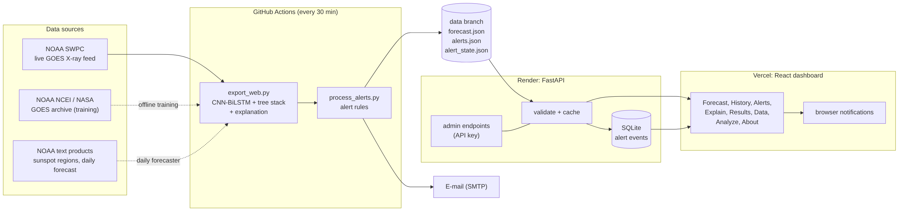
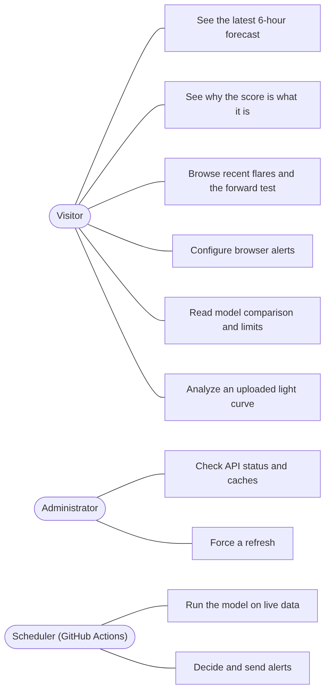
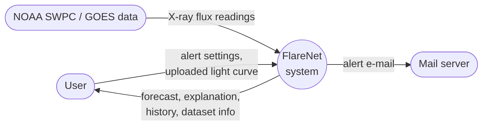
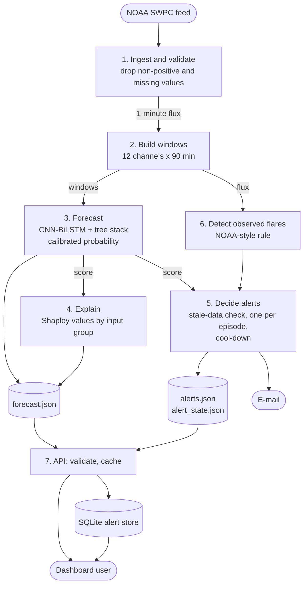
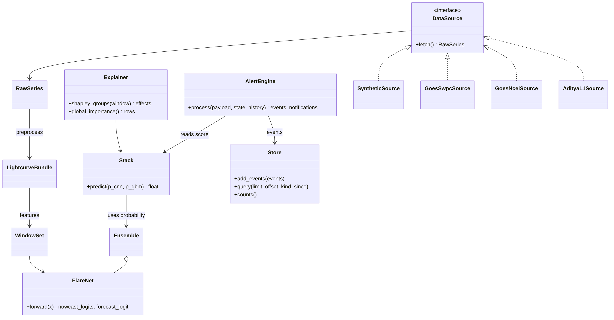
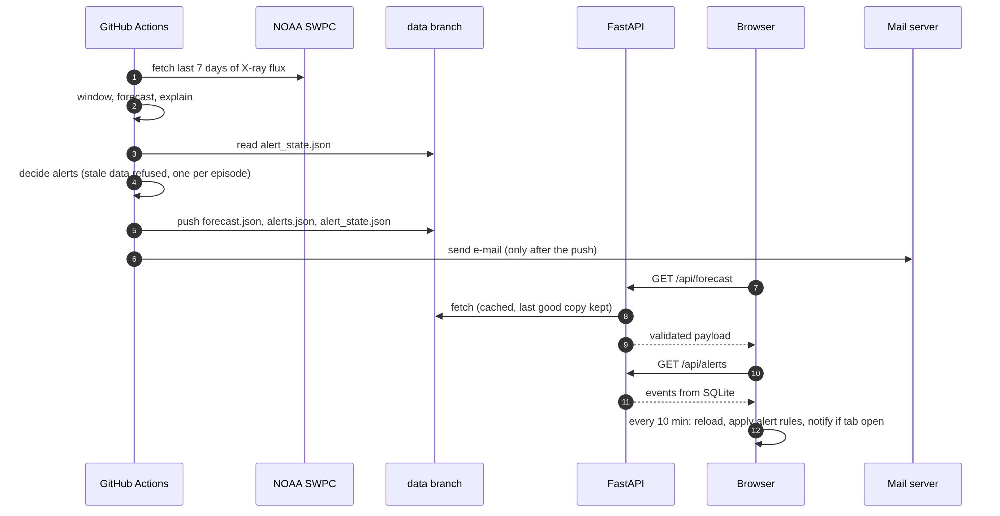
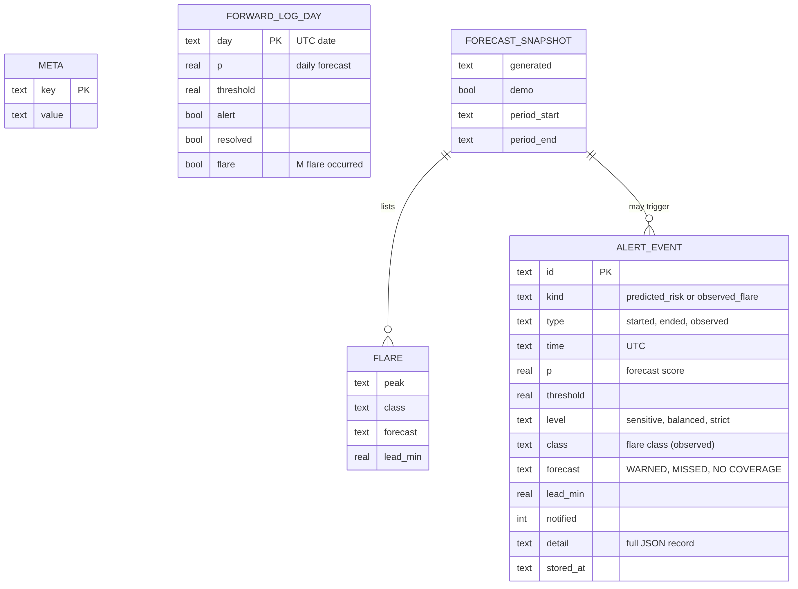

# FlareNet: Solar Flare Forecasting and Alerting from GOES X-ray Data

**Project report for the Bachelor of Technology (Computer Science and Engineering)**

| | |
|---|---|
| Student | [your name] |
| Roll number | [roll number] |
| Guide | [guide's name and designation] |
| Department / College | [department, college, university] |
| Year | [academic year] |
| Source code | https://github.com/ypunit757-prog/Flarenet |

> **How to use this file.** Everything in it describes what the project really does and what was really measured. Square brackets
> mark what only you can fill in. Section 9.2 has blanks for the model-comparison numbers, which have to be produced on real data
> (commands in Appendix A); until they are, no number is given. The diagrams are in `docs/diagrams/` as PNG files (for Word) and as
> Mermaid sources (`.mmd`, editable). The reference list was written from memory: check each entry before you submit.

---

## Abstract

Solar flares are sudden releases of energy from the Sun. The strongest (class M and X) can disturb radio communication and
satellite operations, so agencies such as NOAA's Space Weather Prediction Center (SWPC) issue forecasts. This project, FlareNet,
is a complete software system that (1) reads the X-ray flux measured by the GOES satellites, (2) forecasts, every 30 minutes,
the probability that an M or X flare starts within the next six hours, (3) explains which parts of the recent X-ray record
produced that probability, (4) raises alerts by browser notification and e-mail under rules that refuse stale or invalid data,
and (5) shows all of this on a web dashboard backed by a documented API.

The forecaster is a one-dimensional convolutional network with bidirectional LSTM heads (CNN-BiLSTM), calibrated so that its
output behaves like a probability, and blended with a gradient-boosted tree model. It was trained on GOES-16 data and tested
on GOES-18, a different satellite, over a later period that played no part in training or calibration. On that test the blend
reached ROC-AUC 0.83 and True Skill Statistic (TSS) 0.49, alerting 64% of the forecast times that preceded an M/X flare, with
61% of alerts being false alarms. The report states plainly what is not shown: the forecaster is not shown to beat NOAA's own
forecast, X-class flares are not separately detected by the nowcast, and ISRO's Aditya-L1 instruments are supported by the code
but untested.

---

## Contents

1. Introduction
2. Existing system and proposed system
3. Literature review
4. Requirements
5. System design
6. Data
7. Methodology
8. Implementation
9. Testing and results
10. Limitations
11. Future scope
12. Conclusion
13. References
- Appendix A: reproducing the results; Appendix B: API; Appendix C: configuration

---

## 1. Introduction

### 1.1 Background
The Sun's X-ray output is measured continuously by the GOES satellites. A flare shows up as a rapid rise and slow decay of the
flux. Flares are classed by peak flux in the 0.1 to 0.8 nm band: A, B, C, M and X, each ten times stronger than the one before
(M starts at 1e-5 W/m², X at 1e-4 W/m²). M and X flares matter operationally.

### 1.2 Problem statement
Build a system that, from X-ray lightcurves alone, forecasts M/X flares a few hours ahead, reports how much to trust each
forecast, explains it, and alerts people without ever alerting on old or broken data, and test it honestly on data it has not seen.

### 1.3 Objectives
1. Ingest GOES X-ray data (live feed and archive) and any other instrument through one common data contract.
2. Forecast M/X flares for the next 6 hours with calibrated probabilities, and report how good the forecast is with standard measures.
3. Compare the deep model with LSTM, Random Forest and XGBoost baselines on identical windows (Section 7.7).
4. Explain each forecast and the model in general (Explainable AI).
5. Provide alerts (browser and e-mail) with configurable sensitivity, history and duplicate prevention.
6. Provide a documented API, tests, containers and deployment configuration.

### 1.3.1 Scope and what is out of scope
In scope: GOES X-ray flux, the 6-hour forecast, the daily forecaster, the dashboard, alerts. Out of scope: images of the Sun,
magnetograms, predicting flare size beyond "M or stronger", and any claim to replace official warnings.

---

## 2. Existing system and proposed system

### 2.1 Existing systems
- **NOAA SWPC** publishes day-ahead flare probabilities, written by forecasters who also see sunspot regions and magnetic
  classifications. These are the standard reference.
- **Research models** (Section 3) mostly use magnetograms of active regions, which need image pipelines and are not live-light to run.
- **Plain thresholds** on current flux (for example "alert when C-class flux is seen") are fast but only report what is already happening.

Weaknesses of what a student or small team can usually reach: results reported with random splits that leak information between
training and test, accuracy quoted on a rare event (a model that never alerts is 90%+ "accurate"), no calibration, no
explanation, and no handling of stale data in the alert path.

### 2.2 Proposed system
FlareNet uses only the X-ray flux, which is public, small and available live. It combines a deep model and a tree model,
calibrates the output, tests on a later period and a different satellite, reports skill measures suited to rare events, and
wraps the model in an alerting and explanation layer with a web interface.

| | Existing (typical) | FlareNet |
|---|---|---|
| Data split | random, leaks across time | chronological with gaps; test on another satellite |
| Metric | accuracy | ROC-AUC, TSS, precision, recall, Brier, calibration, with 95% intervals |
| Probability | raw score | calibrated (Platt scaling on a later validation year) |
| Explanation | none | Shapley values by input group (per forecast and global) |
| Alerts | none or fixed | three sensitivity levels, one alert per episode, cool-down, stale-data refusal |
| Forecast vs observation | often mixed | stored and worded separately |

---

## 3. Literature review

Solar flare forecasting by machine learning is an active field. The works below shaped the choices in this project.

- **Bobra and Couvidat (2015)** predicted flares from features of the Sun's magnetic field in SDO/HMI data with a support vector
  machine, and argued for evaluating with skill scores rather than accuracy.
- **Bloomfield et al. (2012)** showed that the True Skill Statistic is the appropriate way to compare forecasts of rare events, because
  it does not depend on how rare the event is. FlareNet uses TSS for model selection and reporting.
- **Barnes et al. (2016)** compared many operational and research flare forecasting methods in a common framework and found that
  methods differ less than the choice of data and evaluation, which is why this project insists on one test protocol for all models.
- **Nishizuka et al. (2017, 2018)** applied several machine-learning methods, then a deep neural network (Deep Flare Net), to
  combined X-ray, ultraviolet and magnetic data and issued probabilistic forecasts.
- **Huang et al. (2018)** and **Park et al. (2018)** applied convolutional networks to magnetogram images.
- **Recurrent networks.** LSTM (Hochreiter and Schmidhuber, 1997) and bidirectional recurrent networks (Schuster and Paliwal, 1997)
  model sequences; FlareNet uses a bidirectional LSTM over features learned by a convolutional front end.
- **Trees.** Random Forests (Breiman, 2001) and gradient boosting, including XGBoost (Chen and Guestrin, 2016), are strong
  baselines on tabular summaries and are used here for comparison and in the blend.
- **Calibration.** Platt scaling (Platt, 1999) maps a score to a probability. **Focal loss** (Lin et al., 2017) is used to train on a
  rare positive class.
- **Explainability.** Shapley values (Shapley, 1953), popularised for machine learning by SHAP (Lundberg and Lee, 2017),
  attribute a prediction to inputs. FlareNet computes them exactly over groups of inputs.

**Gap addressed.** Most published models use magnetic data. A flux-only model cannot match one that sees active regions on
information, but it can run live from a public feed, and its honest test, calibration, explanation and alert handling can be
shown end to end. FlareNet is that engineering system, not a claim of new state-of-the-art skill.

---

## 4. Requirements

### 4.1 Functional
| ID | Requirement | Where |
|---|---|---|
| F1 | Read GOES X-ray data (live, archive, files) and other instruments | `src/flarenet/sources/` |
| F2 | 6-hour M/X forecast with calibrated probability | `src/flarenet/models/`, `gbm6h/` |
| F3 | Compare CNN-BiLSTM, LSTM, Random Forest, XGBoost | `src/flarenet/compare/`, `scripts/compare_models.py` |
| F4 | Explain forecasts | `src/flarenet/explain/`, Explain page |
| F5 | Alerts: thresholds, M/X, e-mail, browser, history, de-duplication, settings | `src/flarenet/alerts/`, Alerts page |
| F6 | Pages: forecast, history, alerts, explain, results, data, analyze, about | `frontend/src/views/` |
| F7 | API with validation, errors, docs, admin key, logging, database, cache, background job | `backend/app/` |

### 4.2 Non-functional
No alert from simulated, stale (over 3 hours) or invalid data. A forecast is never presented as an observation. Every result
shown on the site is either measured or labelled as unmeasured. The API runs without PyTorch on a small host.

### 4.3 Software and hardware
Python 3.10 to 3.12, PyTorch (CPU is enough for inference; training was done on a Mac with Apple GPU support), scikit-learn,
XGBoost (optional), FastAPI, SQLite, React 18 with Vite, Node 22 for development. Hosting: GitHub Actions (model runs), Render
(API), Vercel (dashboard). Docker files are provided.

---

## 5. System design

### 5.1 Architecture


A scheduled GitHub job fetches the last 7 days of GOES X-ray flux from NOAA SWPC, runs the model, builds the explanation, applies
the alert rules and publishes three small JSON files to a `data` branch. The API reads those files (validating and caching them,
keeping the last good copy if the source is down); the dashboard reads the API. The model is not run in the API, which keeps
the API small and cheap.

### 5.2 Use cases


### 5.3 Data flow
Context level (level 0):



Level 1:



### 5.4 Classes


The code is organised around a data contract: `DataSource` produces a `RawSeries`; preprocessing makes a regular 1-minute
`LightcurveBundle` with labels; feature extraction makes a `WindowSet` of 12-channel windows. Nothing downstream knows which
instrument produced the data, which is how GOES, a synthetic generator and Aditya-L1 share one pipeline (`docs/ARCHITECTURE.md`).

### 5.5 Sequence of one refresh


### 5.6 Database design


Two tables live in SQLite in the API (`alert_events`, `meta`). The forecast snapshot, the flare list and the daily forward log
are documents (JSON or CSV) kept on the `data` branch and read by the API, so they appear as entities but not as tables.
`alert_events` has an index on time and on (kind, time). Queries use bound parameters only.

**Why SQLite.** The alert history is small (capped at 500 events), written by one job, and can be rebuilt from the JSON on the
`data` branch. The free hosting plan has no persistent disk, so the database is a rebuildable cache, which is acceptable here.
PostgreSQL would add a managed database for data already stored safely in Git. If several API instances or user accounts were
needed, `backend/app/store.py` (three methods) is the only part to replace.

### 5.7 API design
Public: `GET /api/forecast`, `/api/alerts` (filters `kind`, `since`, paging), `/api/forward-log`, `/api/health`, `/docs`.
Admin (header `X-Admin-Key`, off unless a key of 16+ characters is set): `GET /api/admin/status`, `POST /api/admin/refresh`.
Errors always have one JSON shape with a request id; the request id is also logged. Details in `backend/README.md`.

### 5.8 Interface
Eight pages: **Forecast** (current state, probability, chart, flares), **History** (flares by day, forecast outcome per flare,
daily forward test), **Alerts** (browser settings, server alert history, episodes), **Explain** (why this score; what the models rely
on), **Results** (measured skill, model comparison, what has not been shown), **Data** (the data on screen, training and test
split, preparation, limits), **Analyze** (upload a flux CSV and find flares with a simple threshold rule), **About**. Layout works from phone to desktop, in light and dark themes.

---

## 6. Data

| Use | Data | Period |
|---|---|---|
| Training | GOES-16 X-ray flux, 1-minute | earliest 78% of the record, from March 2017 |
| Calibration and alert levels | GOES-16 | next 12% (a later year, 2023 to 2024) |
| Weaker check | GOES-16 | latest 10% (mid-2024 to April 2025) |
| Final test | GOES-18 (another satellite) | April 2025 to September 2026 |
| Live forecast | NOAA SWPC GOES feed | last 7 days, refreshed every 30 minutes |

Splits are chronological with a gap (window plus horizon, 13.5 hours) cut from the end of each part so no window or label crosses a
boundary. The final test is 12,668 forecast times, 1,646 of them followed by an M/X flare within 6 hours.

**Preparation.** Non-positive or missing flux values are treated as missing, never filled. The flux is put on a log scale. Twelve channels
are derived (log flux in the long and short GOES X-ray bands, their first and second derivatives, the hardness ratio, rolling maxima, an exponentially
weighted mean, fluence and recent flare rate; the short band is optional and is left out when a source does not provide it). Windows of 90 minutes with
too many missing values are not scored. Flares are found with an NOAA-style rule on the flux, which can differ from NOAA's own
list by minutes. Inputs are normalised with training-window statistics only.

---

## 7. Methodology

### 7.1 Task
For each time t, using the previous 90 minutes: output the probability that an M or X flare starts within the next 6 hours
(forecast), and the class of the flare in progress (nowcast).

### 7.2 Model
```
12 channels x 90 min -> Conv1D(7) + BN + ReLU
 -> ResBlock(k=5) -> ResBlock(k=3) -> channel dropout -> MaxPool(2) -> ResBlock(k=3)   (shared encoder)
 -> 1-layer BiLSTM -> MLP -> 5-class nowcast logits
 -> 2-layer BiLSTM -> attention pooling -> MLP -> 1 forecast logit
```
122,087 parameters per network. Training uses focal binary cross-entropy for the forecast, label-smoothed class-weighted cross-entropy
for the nowcast, AdamW with cosine decay and early stopping on validation TSS. The deployed model is one network (the configuration trains an ensemble of three only when `training.ensemble_size` is set above 1).

### 7.3 Calibration and alert levels
The raw score is not a probability (training re-balances classes). A Platt scaling fitted on the later validation year maps it to
one; this changes no ranking. Three alert levels are fixed on that validation year and stored in the checkpoint: **sensitive** (catches at
least 90% of flare windows), **balanced** (best TSS, the default) and **strict** (at most 50% false alarms).

### 7.4 Tree model and the blend
A gradient-boosting model reads summaries of the last three days of X-ray history. A logistic blend of the calibrated network
probability and the tree probability gives the final score. The first three days of the 7-day live chart use the network alone.

### 7.5 Daily forecaster (separate product)
`flarenet daily` forecasts "an M flare or stronger on tomorrow's UTC day" at NOAA's issue time (22:00 UTC) using flux, flare
history, 27-day rotation recurrence and NOAA's sunspot-region reports, with walk-forward testing, a recalibrated NOAA baseline on
the same days, and block bootstrap intervals. A frozen model writes a forward log daily so that no one can tune it after seeing outcomes (`docs/FORWARD_TEST.md`).

### 7.6 Explainable AI
Each forecast is explained by **exact Shapley values over groups of inputs** (for example "flux level now", "rise over the last 30
minutes", "flares in the last 24 hours"), measured in log-odds against a typical window. There are about a dozen groups, so every
ordering is evaluated, and the contributions add up exactly to the difference from the typical score. The Explain page shows them
with their sign written out. Globally, `scripts/explain_model.py` measures how much ROC-AUC each group's removal (shuffling between windows)
costs, for the network and for the trees; with `--shap`, SHAP values of the tree model are also written. An explanation says what moved the model's
number, not what caused a flare.

### 7.7 Model comparison protocol
`scripts/compare_models.py` trains CNN-BiLSTM, an LSTM (a recurrent baseline without the convolutional front end), Random Forest and
XGBoost (and the tree model and the blend of it with the CNN-BiLSTM) on the same chronological split, picks each model's alert threshold on the
validation year only, and scores all of them on the same test windows with accuracy, precision, recall, F1, ROC-AUC, PR-AUC, TSS,
Brier score, confusion matrices, ROC and PR curves, and paired block-bootstrap intervals of the differences from the CNN-BiLSTM.
Because neural-network training varies from run to run, a difference whose interval contains zero is reported as "not established".

### 7.8 Metrics and why not accuracy
M/X flares are a small share of windows, so "never alert" has high accuracy. **TSS** = hit rate minus false-alarm rate (0 means no
skill; independent of how rare the event is). **ROC-AUC** measures ranking quality. **Precision** is the share of alerts followed by a flare. **Brier
score** and the calibration error measure whether probabilities can be trusted. Intervals come from resampling 3-day blocks
because neighbouring windows are not independent.

### 7.9 Alert logic
1. Refuse the data if it is a demo, older than 3 hours, in the future, or its newest score is missing or outside [0, 1].
2. An alert starts when the score reaches the chosen line and the previous state was below it; it ends when it falls back.
3. One notification per episode; a cool-down (default 180 minutes) between announcements.
4. Flares seen in the X-ray reading are announced once, only if recent (3 hours), and stored as `observed_flare`, separately from `predicted_risk`.
5. State is saved before any e-mail is sent, and workflow runs queue rather than cancel, so one alert is never sent twice.

The same rules run in Python on the server (e-mail, history) and in JavaScript in the browser (notifications), each with tests.

---

## 8. Implementation

| Part | Technology | Notes |
|---|---|---|
| Pipeline and models | Python, PyTorch, scikit-learn | package `flarenet`, CLI `flarenet`, YAML configs, cached stages |
| Model comparison, explanation | Python | `compare/`, `explain/`; strict-JSON writer (no `NaN` in files the browser reads) |
| Scheduled job | GitHub Actions | `refresh-forecast.yml`, every 30 minutes; `daily-forward-log.yml` |
| API | FastAPI, SQLite | validation, JSON errors, request ids, admin key, background refresh, cache with last-good fallback |
| Dashboard | React, Vite, react-router (hash routes) | no chart library; SVG drawn by the app; light/dark; phone layout |
| Notifications | Browser Notification API | only while a tab is open; refreshes the forecast every 10 minutes |
| Packaging | Docker, docker-compose, Render blueprint, Vercel | `docs/DEPLOY.md` |
| Quality | pytest, ruff, node:test, GitHub Actions CI | backend, frontend and Docker image jobs |

**Deployment.** The dashboard (Vercel) calls the API (Render), which reads the `data` branch. Environment variables and secrets
(SMTP login, admin key) are listed in `backend/.env.example` and `docs/DEPLOY.md`; none are in the repository.

**Honesty rules built into the code.** The page shows "simulated demo" whenever it is showing simulated data; the Results page
shows no number that was not measured; stale data is shown as "out of date" and never alerts; every forecast is described as a
forecast.

---

## 9. Testing and results

### 9.1 Software testing
At the time of writing: 283 tests for the pipeline and models (including end-to-end runs that train tiny models, file-format and
HTTP tests against local servers, alert rules, model comparison and explanation), 33 tests for the API (endpoints, validation,
errors, admin key, database, caching, background refresh) and 40 tests for the dashboard (alert rules in the browser, helper
functions, and rendering of every new page and component). Continuous integration runs all three, lints, builds the site and builds
and starts the API container. The alert logic was also checked end to end in a real browser with a controlled clock: nothing is
announced when alerts are switched on, one notification is shown when the score crosses the line, and none while it stays above it.

What was not tested: the live NOAA endpoints from the build environment (they were not reachable there; they run in GitHub
Actions), and the Docker image build (no container runtime was available there; the CI job does it).

### 9.2 Model results

**6-hour forecast, measured** (neural network + tree model; GOES-18, April 2025 onward, never seen in training; 12,668 forecast
times, 1,646 followed by an M/X flare within 6 hours):

| Measure | Value |
|---|---|
| ROC-AUC | 0.83 |
| TSS | 0.49 |
| Pre-flare forecast times alerted (default level) | 64% |
| Alerts that were false alarms | 61% |
| Calibration error / Brier score | 0.014 / 0.086 |
| Network alone: ROC-AUC / TSS | 0.81 / 0.45 |

Gain of the blend over the network alone (95% intervals): ROC-AUC +0.022 (+0.011 to +0.032), TSS +0.043 (+0.016 to +0.075), alerted
share +6 points (+3 to +9). The change in false alarms (+0.8 points, interval -1.2 to +2.5) is not established. On the weaker
GOES-16 check the AUC gain was only +0.009 (0.000 to +0.019), so the gain should be read as roughly +0.01 to +0.02, not as settled.

**Model comparison (LSTM, Random Forest, XGBoost): not yet measured.** Run Appendix A and paste the values here. Do not write
numbers in this table that did not come from `model_comparison.md`.

| Model | Accuracy | Precision | Recall | F1 | ROC-AUC | TSS |
|---|---|---|---|---|---|---|
| CNN-BiLSTM | [ ] | [ ] | [ ] | [ ] | [ ] | [ ] |
| LSTM | [ ] | [ ] | [ ] | [ ] | [ ] | [ ] |
| Random Forest | [ ] | [ ] | [ ] | [ ] | [ ] | [ ] |
| XGBoost | [ ] | [ ] | [ ] | [ ] | [ ] | [ ] |

Include the generated figures `roc_pr_<set>.png` and `confusion_<set>.png`, and state for each pair whether the 95% interval of the
difference from the CNN-BiLSTM excludes zero. Describe a difference with an interval containing zero as "not established".

**Nowcast (class of the flare now), measured:** accuracy 0.97, macro F1 0.55 on GOES-18. **X-class is not detected: 0 of 13.** The
rise from the previous model is not shown to be real because of seed-to-seed spread. On GOES data a plain flux rule reads the
class exactly; the learned nowcast matters for instruments without calibrated classes.

**Daily forecaster vs NOAA:** one retrospective walk-forward run over March 2019 to September 2026 found the forecaster level with
NOAA through 2024 and ahead of NOAA in 2025 and 2026, but **not established as better overall**. The forward test
(`docs/FORWARD_TEST.md`) records forecasts before each day and is the evidence that settles it; the Results page and History page
show how many days have been scored, and it is too few days to judge until about a month or more has accumulated.

### 9.3 Explanation results
The Explain page needs the explanation of the live forecast (produced by the refresh job) and the global importance file from
`scripts/explain_model.py`. Global importance on real data has not yet been produced, so no ranking of inputs is claimed here.
[After running Appendix A, add the top three input groups for each model and the two sentences of interpretation.]

---

## 10. Limitations

1. **Flux only.** The 6-hour model has no information about active regions or magnetic fields, which is what flare physics is built on.
   This bounds its skill and is why it is not claimed to match NOAA.
2. **Not shown to beat NOAA.** The daily comparison is level in part of the period and ahead in part, overall not established.
3. **No X-class forecast.** The forecast is "M or stronger". The nowcast did not detect X-class flares in the test (0 of 13).
4. **Alerts are not official.** Only NOAA SWPC issues official space weather alerts.
5. **Instruments.** ISRO Aditya-L1 (SoLEXS, HEL1OS) is supported by the code and configs but has not been tested on real data.
6. **Browser notifications** work only while a tab is open. E-mail works with the page closed but runs on GitHub's schedule, which can be late.
7. **A single test satellite and period** for the headline result; neural-network training is variable, so differences of 0.01 AUC should not be over-read.
8. **Data quality.** Flare times use an NOAA-style rule and can differ from NOAA's catalogue by minutes; gaps in the feed lower coverage.
9. **Free-tier hosting.** The API may sleep when idle, so the first request after a quiet period can take up to a minute.

---

## 11. Future scope
- Add magnetogram-derived features (for example SDO/HMI active-region parameters) to the tree model and measure the gain.
- Run the Aditya-L1 evaluation once several weeks of data are available, with a calibration against GOES on the same days.
- A dedicated X-class model, which needs a data-augmentation or class-balancing study because X flares are rare.
- Push notifications for a closed browser (web push with a service worker) and SMS/Telegram channels.
- Move the alert store to PostgreSQL if user accounts or several API instances are needed.
- Probabilistic ensembles with uncertainty intervals on each forecast.

---

## 12. Conclusion
FlareNet shows a complete, honest path from public satellite data to a deployed forecast with explanation and alerts. Its 6-hour
forecast has real, measured skill on a different satellite and a later period (ROC-AUC 0.83, TSS 0.49), well-calibrated
probabilities, and a documented cost in false alarms. The project separates what has been demonstrated from what has not, keeps
forecasts apart from observations, refuses to alert on bad data, and ships with tests, containers and documentation so that every
number can be reproduced.

---

## 13. References
*(Written from memory: check authors, years and page numbers against the originals before submitting.)*

1. Bobra, M. G., and Couvidat, S. (2015). Solar flare prediction using SDO/HMI vector magnetic field data with a machine-learning algorithm. *The Astrophysical Journal*, 798, 135.
2. Bloomfield, D. S., Higgins, P. A., McAteer, R. T. J., and Gallagher, P. T. (2012). Toward reliable benchmarking of solar flare forecasting methods. *The Astrophysical Journal Letters*, 747, L41.
3. Barnes, G., et al. (2016). A comparison of flare forecasting methods. I. Results from the "All-Clear" workshop. *The Astrophysical Journal*, 829, 89.
4. Nishizuka, N., Sugiura, K., Kubo, Y., Den, M., Watari, S., and Ishii, M. (2017). Solar flare prediction model with three machine-learning algorithms using ultraviolet brightness, X-ray, and magnetic field data. *The Astrophysical Journal*, 835, 156.
5. Nishizuka, N., Sugiura, K., Kubo, Y., Den, M., and Ishii, M. (2018). Deep Flare Net (DeFN) model for solar flare prediction. *The Astrophysical Journal*, 858, 113.
6. Huang, X., Wang, H., Xu, L., Liu, J., Li, R., and Dai, X. (2018). Deep learning based solar flare forecasting model. I. Results for line-of-sight magnetograms. *The Astrophysical Journal*, 856, 7.
7. Park, E., Moon, Y.-J., Shin, S., et al. (2018). Application of the deep convolutional neural network to the forecast of solar flare occurrence using full-disk solar magnetograms. *The Astrophysical Journal*, 869, 91.
8. Hochreiter, S., and Schmidhuber, J. (1997). Long short-term memory. *Neural Computation*, 9(8), 1735-1780.
9. Schuster, M., and Paliwal, K. K. (1997). Bidirectional recurrent neural networks. *IEEE Transactions on Signal Processing*, 45(11), 2673-2681.
10. Breiman, L. (2001). Random forests. *Machine Learning*, 45, 5-32.
11. Chen, T., and Guestrin, C. (2016). XGBoost: a scalable tree boosting system. *Proceedings of KDD 2016*.
12. Platt, J. (1999). Probabilistic outputs for support vector machines and comparisons to regularized likelihood methods. In *Advances in Large Margin Classifiers*.
13. Lin, T.-Y., Goyal, P., Girshick, R., He, K., and Dollar, P. (2017). Focal loss for dense object detection. *Proceedings of ICCV 2017*.
14. Shapley, L. S. (1953). A value for n-person games. In *Contributions to the Theory of Games II*.
15. Lundberg, S. M., and Lee, S.-I. (2017). A unified approach to interpreting model predictions. *Advances in Neural Information Processing Systems 30*.
16. NOAA Space Weather Prediction Center: GOES X-ray flux and daily forecast products. https://www.swpc.noaa.gov/

---

## Appendix A: reproducing the results

Run on your own computer (these need the real data, which the build environment could not reach).
```bash
cd "/Users/anurag/Downloads/flarenet "
uv sync --python 3.12 --extra netcdf --extra ml

# the 6-hour model and its validation (already done once; reuses downloaded data)
uv run flarenet run -c configs/noaa_all_chrono.yaml

# model comparison: CNN-BiLSTM, LSTM, Random Forest, XGBoost on identical windows
uv run python scripts/compare_models.py -c configs/noaa_all_chrono.yaml
#   -> runs/<run>_compare/model_comparison.md, .json, roc_pr_*.png, confusion_*.png
cp runs/<run>_compare/model_comparison.json frontend/public/model_comparison.json

# explanation of the models
uv run python scripts/explain_model.py -c configs/noaa_all_chrono.yaml \
   --checkpoint models/flarenet.pt --stack models/gbm6h_live.pkl --shap
#   -> models/explain_global.json (shown on the Explain page), explain_importance.png
```
The comparison trains several networks and can take a long time; `--lstm-epochs`, `--train-stride` and `--skip xgboost` shorten it.

## Appendix B: tests
```bash
uv run pytest                                  # pipeline and models
cd backend && python -m pytest tests -q        # API
cd frontend && npm ci && npm test && npm run build
```

## Appendix C: configuration
All settings, defaults and where to set them (GitHub secrets and variables, Render variables, local `.env`): `docs/DEPLOY.md` and `backend/.env.example`.
